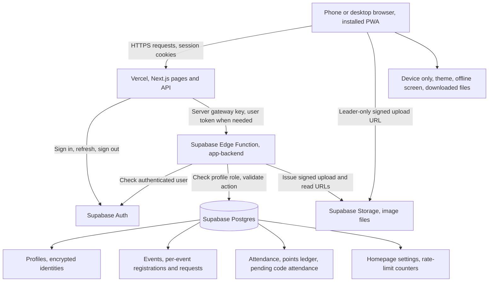
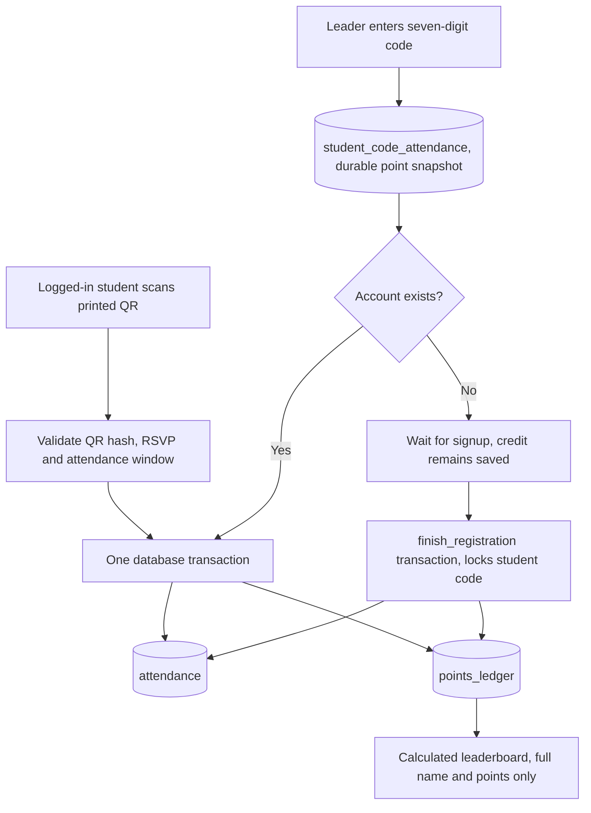

# What the app saves

Verified against the source and live Supabase schema and attendance functions on 18 November 2026, Cairo time. This describes the current implementation, not a proposed architecture. No student records were inspected for this explanation.

The browser does not directly read or write application tables. Next.js rejects cross-origin mutation requests; the Edge Function checks the server gateway key and authenticates members, then reads the current role from `profiles` for leader actions. All ten public tables have RLS enabled. The service key and national-ID encryption key stay on the server. These controls reduce risk; they are not a guarantee against every attack.

## Action-by-action record map

| Action | Persistent result | What is not saved by that action |
| --- | --- | --- |
| Create account | Supabase Auth user and password hash; `profiles`: name, seven-digit student code, phone, role, recovery-code hash, creation time; `identities`: encrypted national ID. Existing pending attendance/points attach during the registration transaction. | No plaintext password, plaintext national ID or plaintext recovery code in application tables. No profile photo, permanent medical record, academic excuse or RSVP created. |
| Log in, session refresh, log out | Auth session/refresh-token state and authentication service logs; browser receives HttpOnly session cookies. Auth endpoints also update rate-limit counters. | No new points, RSVP or event attendance. Password is processed by Auth, not stored as plaintext by the application. |
| Recover password | Auth password hash replaced; `profiles.recovery_hash` replaced with a fresh recovery-code hash. Code consumption uses a conditional claim to prevent reuse. | National ID is not used for password recovery. New plaintext recovery code is returned once to the browser, not kept as a retrievable application record. |
| Change contact details | Only `profiles.phone` and `profiles.email` change. | Name, student code, role and national ID cannot be edited through this form. Contact email is not the student-code login alias. |
| Confirm or edit participation | One `registrations` row per event and student: `going=true`, accommodation text, excuse text, `request_status=accepted`, creation time. Subsequent saves update that row. | No points or attendance from RSVP alone. No approval queue. Requests are not copied to the permanent profile or shown to other students. |
| Cancel participation | The registration remains, with `going=false`. | This is not deletion: existing request text is retained. It does not erase attendance or already awarded points. |
| Scan attendance inside app | `attendance`: event, student, check-in time and actor; `points_ledger`: event, student, points and time. Both inserts run in one database transaction. | No camera frames or video are uploaded. Raw printed QR secret is not saved in the scan records. Duplicate scans do not grant duplicate points. |
| Leader records a student code | `student_code_attendance`: event, code, point snapshot, recording leader and time. If an account exists, attendance and ledger rows are also inserted in the same transaction. | No fake account or RSVP is created. For an unknown code, points are kept pending until signup. |
| Unknown-code owner signs up later | Registration transaction joins saved code attendance to the new profile, inserting attendance and ledger records using their original points and timestamps. | Pending source rows are retained; duplicate constraints prevent a second award. A shared code lock coordinates concurrent signup and manual entry. |
| Leader creates event | `events`: title, description, place, dress code, start/end, points, cover reference, creator and QR hash. | Raw QR secret is returned only in the creation response. It is not stored in plaintext for later reprinting, so the leader should download the QR at creation. An unsaved form is not a database record. |
| Leader uploads image | JPEG object and storage metadata in `event-images` or `site-images`. Uploads use unique paths and do not overwrite old objects. Event images are private; homepage images are public. | Upload alone does not create an event or save a homepage reference. Image bytes are not stored in an `events` row. Selecting then cancelling can leave an unused uploaded object. |
| Save homepage media | `app_settings`, key `home`, stores video URL, fallback image URL and gallery image references. | Removing/replacing a reference does not delete the old storage object. Videos are linked, not uploaded by the current form. |
| Browse homepage, events, account, leaderboard, leader rosters/stats | Reads existing records. Leaderboard totals and counts are calculated from existing rows, not separately maintained rankings. Public data can use a short CDN cache. | No attendance or RSVP from merely opening a page. Authenticated reads can still update technical rate-limit counters; service logs may record requests. |
| Download Excel or PDF | File is generated and downloaded in the browser from the current permitted roster/view. | No export file or export-history row is uploaded or saved in the application database. The downloaded report does contain the permitted participant/request data and remains on the recipient's device. |
| Theme, menu, filters, password eye, form typing | Theme preference in localStorage; other UI state in browser memory. Event drafts survive modal close in the current page session. | No application-table write. Unsaved input is not durable across reloads. Showing the password does not save it anywhere new. |
| Install PWA or lose connection | Browser/OS install metadata; service worker cache contains only the offline page and two public app icons. | No private API responses, account pages, passwords, IDs or queued attendance mutations in the service worker cache. Offline actions are not silently submitted later. |

The removed news feature has no current UI or action handler. Historical `news` rows remain in the database; removing a feature did not erase those records.

## Attendance and points, including students without accounts

Student self-scan requires an active RSVP and is open from one hour before the start through one hour after the end. Leader code entry opens one hour before the event and can also record past attendance. Unique event/student and event/code keys prevent repeated credit. Success is only displayed after the API confirms saving; a subsequent profile-refresh failure has a separate retry state.

## Access and retention

Guests see the homepage, public leaderboard names/points and past events. Upcoming event details require login. Students see their own contact details, registrations, requests and point history. Leaders receive event rosters, phone numbers, codes and per-event medical/accommodation and academic-excuse text for organising the event. Neither leader rosters nor student APIs return national IDs or recovery hashes. Encrypted IDs are still sensitive data, not anonymous data.

There is currently no automatic application retention/deletion schedule for IDs, event requests or attendance, and no separate per-action business audit-log table. Attendance records retain actor/time; event records retain creator. Infrastructure logs are separate and have provider-controlled retention. The application does not intentionally log passwords, national-ID request bodies or recovery codes.

## Reliability limits

Transactions and uniqueness protect a single committed attendance award. They do not replace backups. Auth user creation and the profile transaction are separate operations with compensating Auth-user deletion on profile failure; they are not one cross-service transaction. Storage upload and saving its event/home reference are also separate operations. An extreme interruption between those steps can require reconciliation. Password recovery similarly spans multiple Auth/database operations.

No new backup service or paid plan was enabled. This audit did not certify a current independent backup/restore procedure or demonstrate 10,000 simultaneous users. Free-tier limits, network availability and provider outages still apply. Offline attendance requires an online retry, not an implied saved result. Physical phone camera and iOS installation were not retested in this change.

Source references: `app/api/auth/route.ts`, `app/api/action/route.ts`, `lib/security.ts`, `lib/supabase.ts`, `lib/backend.ts`, `supabase/functions/app-backend/*`, `supabase/migrations/*`, `components/leader-attendance.tsx`, `components/image-upload.tsx`, `public/sw.js`.
