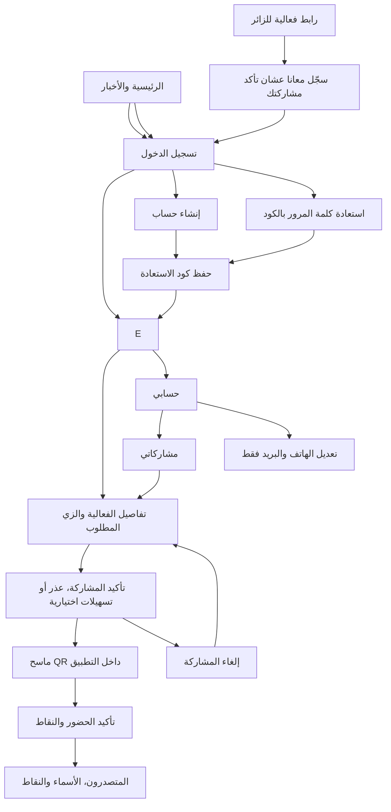
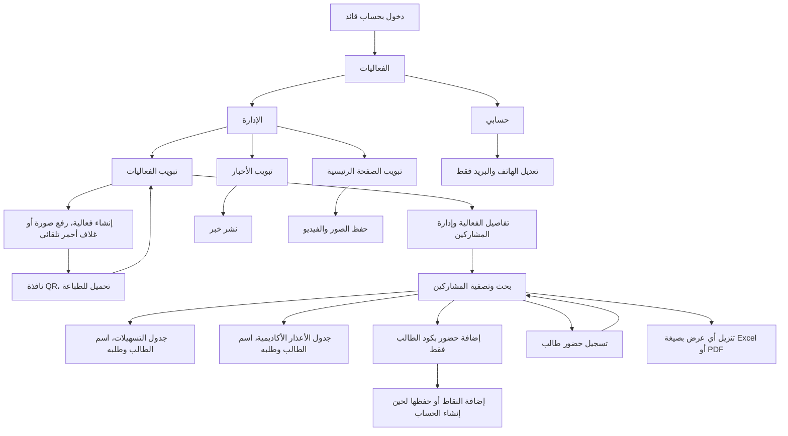

# مسارات الشاشات

المخططات توضح الواجهة الحالية. بعض المربعات نوافذ أو تبويبات داخل الصفحة. الصفحة الرئيسية تعرض الأخبار. المتصدرون متاحون للزائر دون تسجيل الدخول، بالأسماء والنقاط فقط. الفعاليات القادمة وتفاصيلها متاحة للطلاب المسجلين والقادة فقط. رابط الفعالية للزائر يعرض إنشاء حساب أو تسجيل الدخول، ثم يرجع لنفس الفعالية لتأكيد المشاركة.

## الطالب

الأعذار والتسهيلات مقبولة تلقائيًا وتخص كل فعالية. الرقم القومي لا يُعرض ولا يُعدّل بعد التسجيل. مسح الرمز يتطلب تسجيل الدخول والتسجيل في الفعالية، ويعمل داخل فترة الحضور المحددة. كود الاستعادة الجديد يظهر عند إنشاء الحساب أو استعادة كلمة المرور، وليس عند كل دخول.

## القائد

القائد يستطيع أيضًا استخدام مسارات الطالب، بما فيها مشاركته الشخصية وماسح رمز حضوره. لا توجد خطوة موافقة على الأعذار أو التسهيلات. لا يمكن للطالب اختيار صلاحية قائد أثناء إنشاء الحساب.

# زر إظهار كلمة المرور

زر عين بجانب كلمة المرور في الدخول وإنشاء الحساب والاستعادة. كلمة المرور مخفية افتراضيًا؛ الضغط يبدل العرض فقط دون تعديل القيمة أو إرسال النموذج. الزر له تسمية عربية ودعم لوحة المفاتيح، ويعود الحقل مخفيًا عند تغيير نوع النموذج أو إغلاقه وإعادة فتحه. لا تُحفظ كلمة المرور بسبب هذه الميزة في أي تخزين محلي أو سجل.

## التحقق والنشر

تم النشر عبر Vercel بالإصدار `dpl_Fd3s5PNxa684ZtANzZ8kK8SosNGV`، من المصدر `9c6ae31`. اجتاز البناء وفحص TypeScript. اجتاز اختبار المتصفح محليًا وعلى النسخة المنشورة: الدخول وإنشاء الحساب والاستعادة، لوحة المفاتيح، ثبات القيمة، عدم إرسال النموذج بالزر، إخفاء كلمة المرور عند تغيير النموذج أو إعادة فتحه، والمظهر الداكن والهاتف. جميع بيانات الاختبار وهمية داخل المتصفح ولا تُرسل إلى حساب حقيقي. لم يجد فحص أخطاء النشر الفوري أي سجل خطأ مطابق.
